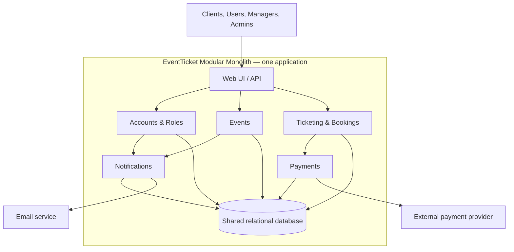

# ADR-001: Use a Modular Monolith for EventTicket

- **Status:** Accepted
- **Date:** 2026-10-28

## Context

EventTicket is a web application for discovering events, publishing events, booking pre-sales, and buying tickets online. It has three user roles: users, managers, and admins. The requirements include account registration and login, personal pages, favourite categories and email notifications, manager event publishing, administrator management of managers, online payment, ticket codes, and password recovery.

Ticket purchases must also protect the ticket inventory from concurrent requests. If only one ticket remains and two users try to buy it at the same time, only one reservation may succeed. Payment can fail or time out after a ticket is reserved, so reservations need a defined release or expiry path.

The system needs clear separation between feature areas, but the requirements do not currently establish a need for independent deployment of each feature or separate scaling of individual services.

## Decision

Build EventTicket as a **modular monolith**: one deployable application, divided into modules with clear responsibilities and interfaces.

Initial modules should include:

- **Accounts and Roles:** registration, login, logout, profiles, password recovery, and role permissions.
- **Events:** event discovery, categories, and manager event publishing.
- **Ticketing and Bookings:** pre-sale bookings, ticket purchases, ticket codes, and the authoritative inventory reservation process.
- **Payments:** online payment coordination and payment status.
- **Notifications:** email preferences and category-based event notifications.

The Ticketing and Bookings module will be the sole authority for ticket availability and reservations. It must reserve inventory atomically so competing purchases cannot sell the same final ticket. A reservation can be held temporarily while payment is processed, then confirmed on successful payment or released when payment fails or the hold expires.

Modules may use shared application infrastructure, but each module should own its business rules and expose a clear interface to other modules. Other modules must not update ticket inventory directly.

## Architecture overview

The diagram shows the main modules in one deployable application. They share a database, while payment processing and email delivery connect to external providers through their owning modules.

Ticketing and Bookings owns inventory reservations and booking state. The shared database supports atomic reservation updates; the other modules use their defined interfaces and do not directly change ticket inventory.

## Alternatives considered

### Layered monolith

One application organized primarily into technical layers, such as presentation/API, business logic, and data access.

- **Benefits:** Simple to build and deploy; transactions can be handled within one application and database.
- **Costs:** If organized only by technical layer, related business features can be spread across the codebase, making ownership and future changes harder to manage.
- **Assessment:** Viable for a small application. It is not inherently worse than a modular monolith; the modular structure is preferred here because it makes feature boundaries explicit.

### Microservices

Separate services for areas such as accounts, events, ticketing, payments, and notifications, deployed and scaled independently.

- **Benefits:** Services can be changed, deployed, and scaled independently; this can suit larger systems or teams with separate service ownership.
- **Costs:** More deployment and monitoring work, network failure handling, distributed tracing, and coordination of data across services. A ticket reservation may succeed while payment is unavailable, requiring retries, idempotency, and a process to release the reservation.
- **Assessment:** The requirements do not yet justify this added operational and consistency complexity.

## Architecture comparison

| Criterion | Layered Monolith | Modular Monolith | Microservices |
|---|---|---|---|
| **Implementation complexity** | Low to moderate: one application and database, organized by technical layers. | Moderate: one application, with additional effort to define and preserve feature-module boundaries. | High: multiple services, APIs or messaging, independent data, and distributed failure handling. |
| **Scalability** | The application is generally scaled as a whole. | The application is generally scaled as a whole; module boundaries improve organization but do not provide independent scaling by themselves. | High: individual services can be scaled independently when their workloads differ. |
| **Maintainability** | Suitable for a small system, though feature changes can cross technical layers and become harder to coordinate as it grows. | Strong: feature responsibilities are explicit, making related rules easier to locate and change. | Can be strong with clear service boundaries and team ownership, but cross-service work and operational complexity add maintenance effort. |
| **Deployment** | Simple: deploy one application. | Simple: deploy one application; modules ship together. | More complex: deploy, configure, monitor, and coordinate multiple services. |
| **Suitability for EventTicket** | **Suitable** for a small first version, but feature boundaries would need care as ticketing, payments, and notifications grow. | **Very suitable / best fit currently:** gives the required features clear boundaries while keeping one deployment and simpler ticket transaction handling. | **Limited fit currently:** valuable if independent scaling or deployment becomes necessary, but the current requirements do not justify its added complexity. |

## Justification

A modular monolith fits EventTicket's current size and requirements because it keeps the application simple to deploy while giving major capabilities clear boundaries. Accounts and roles, event management, ticketing, payments, and notifications have distinct responsibilities and can be developed as modules without requiring separate services.

Ticket sales benefit from keeping inventory reservation and booking updates close to the authoritative ticket data. Atomic database operations can ensure that only one concurrent purchase reserves the last ticket. Payment failures can be handled with a temporary reservation and explicit expiry or release behavior.

The design also leaves room to extract a module into a separate service later if real scale, team ownership, or operational needs justify it. That future option depends on maintaining module boundaries and avoiding uncontrolled cross-module data access.

## Trade-offs

- The application is easier to build, deploy, and debug than a set of microservices, but the whole application is deployed as one unit.
- Modules improve separation of concerns, but they share a runtime and may initially share a database; module boundaries must be enforced through code and review.
- A shared database makes atomic ticket reservation and booking workflows simpler, but it can make later service extraction harder if modules freely access one another's tables.
- Independent scaling of one feature is limited compared with microservices, though this is not currently an established requirement.
- Payment processing remains an external interaction. Even in a monolith, failed or delayed payment responses must be handled safely, and retries must not create duplicate charges or bookings.

## Risks and mitigations

| Risk | Mitigation |
|---|---|
| Two concurrent purchases oversell the final ticket. | Make Ticketing the sole inventory owner and use atomic reservation logic in the database; only one competing reservation may succeed. |
| Payment fails after inventory is held. | Use a temporary reservation with expiry and release rules; confirm the ticket only after successful payment. |
| Retries create duplicate bookings or charges. | Use idempotent purchase and payment operations with stable request identifiers. |
| Modules become tightly coupled despite the modular design. | Define module interfaces, limit direct access to another module's data, and keep business rules with the owning module. |
| A single application becomes difficult to scale or release as usage grows. | Monitor actual load and team needs; extract a module only when there is a concrete operational reason, preserving its boundary now. |
| Email delivery delays affect user experience. | Treat notification delivery as a separate responsibility and allow it to be queued or retried without blocking ticket reservation and payment. |

## Consequences

- The initial system has one application deployment and can use one relational database.
- The Ticketing and Bookings module owns inventory and booking state; Payments reports payment outcomes through a defined interface.
- Event discovery, account management, and notifications remain modules in the same application initially.
- The team must maintain module boundaries to keep the codebase understandable and make possible future extraction less costly.
- Microservices can be reconsidered if independent scaling, deployment, or team ownership becomes a demonstrated need.

## Discussion notes and ADR change log

- **Initial architecture comparison:** Identified layered monolith, modular monolith, and microservices as possible approaches. Modular monolith was suggested as a reasonable starting fit.
- **Clarification on layered design:** A layered monolith is not inherently worse. Both layered and modular monoliths can use technical layers; the modular monolith additionally organizes code by feature area.
- **Ticket concurrency discussion:** Added the requirement that a single authoritative ticketing component atomically reserves inventory. A temporary hold protects the ticket while payment is processed.
- **Microservices trade-offs discussion:** Recorded additional deployment, monitoring, network-failure, and cross-service consistency work, especially around ticketing and payment.
- **ADR decision:** Selected modular monolith as the accepted architecture for EventTicket because it provides clear feature boundaries with less operational complexity than microservices, while retaining the simplicity of one deployment.
- **Comparison-table revision:** Added a side-by-side comparison of Layered Monolith, Modular Monolith, and Microservices for implementation complexity, scalability, maintainability, deployment, and EventTicket suitability. The table clarifies that layered monolith remains suitable for a small system, while modular monolith is the best fit for the current scope.
- **Architecture-diagram revision:** Added a simple Mermaid overview showing user roles entering through the web UI/API, the EventTicket modules and their interactions, their shared relational database, and external payment and email services. The diagram emphasizes that the modules remain within one deployable application.
