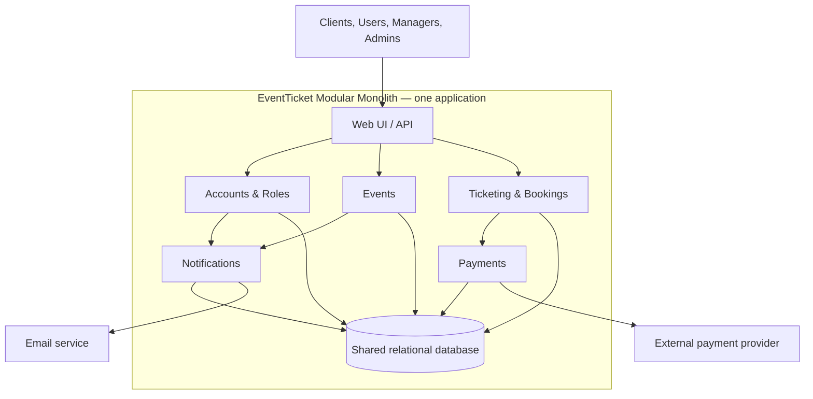

Me:
Based on our discussion of the architectures for EventTicket, create an Architecture Decision Record (ADR) for the system. Please continue taking notes throughout our discussion, including the changes and improvements we make to the ADR. The ADR should include the context, architectural decision, alternatives considered, justification, trade-offs, risks, and consequences. Use the architecture modular monolith since you have picked it as the best option and explain why it is appropriate for EventTicket.

AI:
Created **ADR-001: Use a Modular Monolith for EventTicket**. It records the accepted decision, context, alternatives, justification, trade-offs, risks, consequences, ticket reservation safeguards, and a discussion/change log.

I’ll continue adding future discussion points and ADR improvements to the change log.

Me: 
The ADR is informative, but I think it would benefit from a comparison table of the three architectures.

Please add a table comparing Layered Monolith, Modular Monolith, and Microservices in terms of complexity (implementation), scalability, maintainability, deployment, and grade for suitability for the EventTicket.

Keep the existing content and update the discussion notes.

AI:
Updated the ADR with a comparison table covering implementation complexity, scalability, maintainability, deployment, and suitability for EventTicket. The discussion notes now record this revision. The existing ADR content remains in place.

The table rates the **Modular Monolith** as the best fit for the current requirements; a **Layered Monolith** is also suitable for a small system, while **Microservices** add complexity the current scope doesn’t yet require.

Me:
The comparison table is good. Now create some visual form for the better understanding.
Add a Mermaid architecture diagram showing the main modules of EventTicket, interactions, shared db, ect.
Keep the diagram simple and update the discussion notes.

AI:
Added a simple Mermaid diagram to the ADR and updated the discussion notes. It shows the user entry point, EventTicket modules, shared database, and external payment and email services.

