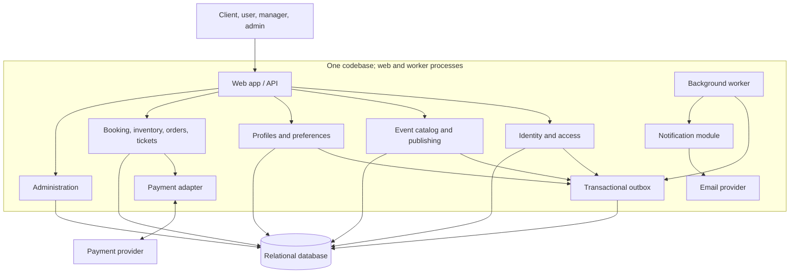

# ADR-001: Architecture for the Event Ticketing Web Application

- **Status:** Proposed
- **Date:** 2026-10-28
- **Decision owner:** Project team
- **Scope:** Application structure and deployment boundaries for the initial event discovery, publishing, booking, ticketing, and account features

## Context

The system is a web application where visitors discover events; users register, manage profile data and favorite categories, book pre-sales, buy tickets, and pay online; managers publish and manage their events; and admins add managers. The system also sends email notifications about favorite categories and supports password recovery.

The requirements establish these capabilities, but do not set service-level targets or implementation constraints. They do not specify expected user or event volume, peak demand, team size, deployment platform, payment provider, ticket capacity rules, or jurisdiction-specific obligations. The choice should therefore support transactional ticketing and a clear path to growth without assuming a distributed system is already necessary.

### Requirements and correctness concerns

- Enforce role-based access: clients, users, managers, and admins have different capabilities. A manager should only manage events they are authorized to manage.
- Keep event publication, bookings, purchases, and user-visible ticket state consistent.
- Prevent ticket capacity from being exceeded when concurrent users book or buy. The precise inventory and hold policy remains a product question.
- Treat payment-provider calls as unreliable and potentially repeated. Use idempotent operations and explicit payment states; issue a paid ticket only after confirmed payment, and define expiration/refund handling with the provider integration.
- Send category notifications reliably without making event publishing depend on email availability.
- Protect account credentials and password recovery flows.

### Assumptions

- The first release can be delivered and operated by one product team; no independent service ownership or separate release cadence is stated.
- A relational database is available and acceptable for transactional data.
- An external payment provider and email delivery service will be integrated, but neither is named in the requirements.
- Initial scale is not specified. The recommendation is for a maintainable starting point, with measured growth as the trigger for further distribution.

## Decision

Recommend a **modular monolith**: one application codebase organized into domain modules, initially released as one web application, with a background worker process using the same codebase for asynchronous email and payment-related jobs. Modules communicate through explicit interfaces and application services rather than reaching into one another's internal data structures.

Use one relational database initially, with schema ownership by module and transactions for critical ticketing operations. Keep external payment and email integrations behind adapters. Record outbound work in a transactional outbox so it can be retried by a worker. Enforce authorization and ticket capacity in server-side application logic and database transactions; do not rely on the browser for these guarantees.

Suggested modules:

- **Identity and access:** registration, login, logout, password recovery, role and permission checks.
- **Event catalog and publishing:** event discovery, categories, manager-owned event creation and lifecycle.
- **Profiles and preferences:** user data and favorite categories.
- **Booking and inventory:** pre-sale reservations, capacity checks, holds/expiry if required.
- **Orders, payments, and tickets:** checkout state, payment integration, paid ticket issuance and ticket codes.
- **Notifications:** outbox processing and email delivery for category notifications and account flows.
- **Administration:** manager creation and administrative operations.

## Architecture diagram

The web application and background worker are deployable processes built from the same codebase. Domain modules share one database at first; table or schema ownership remains explicit. The outbox is persisted in that database, and the worker retries delivery. The payment provider is external; its exact protocol and webhook behavior remain to be selected.

## Alternatives considered

### Option A: Layered monolith

A single application is organized primarily by technical layers: presentation/controllers, business services, and persistence/data access. The layers provide a simple request path and one deployment. Domain boundaries such as ticketing, events, and identity may be represented by folders or service classes but are not the main organizing principle.

**Advantages:** Lowest initial deployment and infrastructure burden; straightforward local development; one database transaction can cover reservation and order state; familiar structure for a small team.

**Disadvantages:** As features accumulate, business rules can spread across layers and unrelated features can become tightly coupled. Shared data models and persistence code make it easier for one feature to change another feature's behavior unintentionally.

**Implementation challenges:** Establish consistent authorization at service boundaries; keep controllers thin; isolate payment-provider details; implement concurrent capacity checks and idempotent payment processing; avoid a broad shared service layer becoming a dependency tangle. These safeguards are possible, but the architecture does not create strong domain boundaries by itself.

### Option B: Modular monolith (recommended)

A single deployable application is divided into domain-focused modules with explicit interfaces and ownership. It can use layers internally within each module. A worker process from the same codebase can handle outbox-driven email and other retryable tasks. It is still one architecture and release boundary; the worker does not imply microservices.

**Advantages:** Keeps deployment and transactional operations simple while making domain responsibilities visible; supports reliable capacity and order updates in database transactions; isolates external integrations; offers a practical path to extract a module later if usage or team ownership justifies it.

**Disadvantages:** Modules still share a runtime, database, and release process; boundaries require discipline and automated checks. Scaling one module independently is not possible without a later change. Poorly defined module interfaces can collapse into a layered monolith in practice.

**Implementation challenges:** Define module APIs and data ownership; prevent direct cross-module table writes; model reservation, payment, cancellation, and ticket issuance as explicit state transitions; implement transactional outbox processing, retries, deduplication, and observability; test role boundaries and concurrent capacity claims.

### Option C: Microservices

Event, identity, ticketing, payment orchestration, and notifications are separate independently deployed services. Each service owns its data and communicates using APIs and/or asynchronous messages. Distributed workflows coordinate booking and payment across service boundaries.

**Advantages:** Teams can deploy and scale selected services independently; service ownership and technology choices can diverge where justified; failures and load can be isolated with suitable design and operations.

**Disadvantages:** Adds network failure modes, distributed data consistency, service discovery, deployment, monitoring, and security configuration. A ticket purchase that touches inventory, order, payment, and ticket issuance is harder to make correct than a single database transaction. The requirements provide no independent scaling, team, or availability needs to offset this cost.

**Implementation challenges:** Define service boundaries and API/versioning rules; build distributed tracing, metrics, secrets management, and deployment automation; make all commands and events idempotent; handle duplicate or delayed provider callbacks; coordinate inventory holds, payment confirmation, compensation/refunds, and eventual consistency; operate message delivery and dead-letter recovery. These challenges are solvable but require significant design and operational maturity.

## Comparison

Ratings are relative to the requirements and stated assumptions: **Low** means less effort or a weaker fit on that criterion; **Medium** means manageable with deliberate design; **High** means greater effort or a strong fit. “Suitability” summarizes fit for the initial system, not universal quality.

| Criterion | Layered monolith | Modular monolith | Microservices |
|---|---|---|---|
| Implementation complexity | Low initially; coupling risk rises as features grow | Medium; modules and contracts need discipline | High; distributed workflows and infrastructure |
| Scalability | Medium; scale the whole application and database | Medium; scale the whole application first; extract later if evidence supports it | High potential for independent scaling, with added operational cost |
| Maintainability | Low to medium; technical layers can blur domain ownership | High if module boundaries are enforced | Medium to high with mature service ownership; otherwise high coordination cost |
| Deployment and operations | Low; one main application | Low to medium; web and worker processes, shared codebase | High; multiple deployments, service discovery, observability, and messaging |
| Ticket and payment consistency | High within a database transaction; external payment still needs idempotency and reconciliation | High for internal state transitions; external payment still needs idempotency and reconciliation | Medium; distributed consistency, retries, and compensation are required |
| Initial delivery fit | Good for a small system, with growing coupling risk | **Best fit** for clear domains without stated distributed scale | Weak fit absent stated scale, team, or isolation needs |

## Justification

The modular monolith best balances the system's correctness-sensitive ticketing workflows with the limited constraints currently known. A single transactional database makes it practical to check capacity and create reservations or orders atomically. Explicit modules give identity, event management, user preferences, ticketing, and notifications clear responsibilities without introducing network calls between every capability.

A payment provider remains an external boundary in every option. The application must use idempotency keys, persist payment state transitions, validate provider callbacks, and reconcile uncertain outcomes. The architecture does not make online payment atomic with the local database; the modular monolith reduces the number of internal distributed steps and makes recovery behavior easier to implement.

The outbox supports retryable notification delivery: a business transaction records the notification intent, then a worker sends it and marks it processed. This avoids losing email work when the email provider is unavailable, while deduplication avoids repeated messages after retries.

Microservices could become appropriate if measured load, independent team ownership, deployment needs, or fault-isolation requirements demand it. The current requirements do not establish those conditions. A layered monolith remains viable for an early prototype, but explicit domain modules better protect the growing set of distinct user and manager workflows.

## Trade-offs

- The team accepts one shared release boundary and whole-application scaling initially, in exchange for simpler operation and transactional ticketing behavior.
- The team must invest in module boundaries, ownership rules, and tests that prevent cross-module coupling.
- The worker introduces asynchronous processing and retry behavior, but avoids blocking user-facing requests on email delivery.
- External payment status can be delayed or ambiguous. Checkout must represent pending, paid, failed, and expired states; users may need a status refresh or recovery path.
- A later service extraction will require explicit contracts and data migration. Module boundaries and ownership rules should be designed so that extraction is possible, but not performed preemptively.

## Risks and mitigations

| Risk | Mitigation |
|---|---|
| Concurrent bookings exceed event capacity | Enforce capacity with transactional locking or atomic conditional updates; define hold duration and expiration policy; test concurrent attempts. |
| Duplicate payment requests or callbacks create duplicate tickets | Use provider idempotency keys, unique payment references, validated callbacks, and idempotent ticket issuance. |
| Payment succeeds but local state is not updated, or vice versa | Persist state transitions; process callbacks and reconciliation jobs; expose pending state and define refund/compensation procedures. |
| Email delivery is delayed or duplicated | Transactional outbox, retry with backoff, idempotent notification keys, monitoring, and a dead-letter/recovery process. |
| Role or ownership checks are bypassed | Centralize policy checks in server-side application services; scope manager actions to owned events; audit sensitive administrative actions. |
| Module boundaries erode over time | Document module APIs and table ownership; prohibit cross-module writes; review dependencies and add boundary checks in CI. |
| Unknown scale or deployment needs invalidate the choice | Track traffic, contention, latency, deployment frequency, and team ownership; revisit when specific thresholds or service-level needs are established. |

## Consequences and implementation guidance

1. Start with a single codebase split into domain modules. Keep web controllers/adapters separate from module use cases and persistence adapters.
2. Use a relational database with module-owned tables or schemas. Critical booking and ticketing writes should occur in transactions with concurrency-safe capacity enforcement.
3. Represent checkout and ticket issuance as explicit state machines. Model provider callbacks and client retries as repeatable inputs.
4. Add a transactional outbox and worker for email and other retryable work. Monitor retry counts and provide a safe path to replay failed messages.
5. Store passwords using a modern password-hashing algorithm; use expiring, single-use password-reset tokens and avoid revealing whether an email address is registered.
6. Enforce role and resource ownership checks server-side. Admin manager creation should be auditable.
7. Keep provider-specific payment and email code behind adapters; do not let provider concepts leak into event or profile modules.
8. Defer message-broker infrastructure and service extraction until measured needs warrant them. Preserve module boundaries so this remains an option.

## Open questions and revisit triggers

- What are the expected event volume, peak concurrent checkout load, and geographic footprint?
- What are the required availability, recovery-time, and response-time targets?
- Which payment provider and payment methods are required? What refund, chargeback, and webhook guarantees apply?
- Do pre-sale bookings reserve inventory, for how long, and what are the rules for expiration, cancellation, and limited-capacity events?
- What regulatory, privacy, data-retention, and audit requirements apply to user and payment-related data?
- What team size, skills, and deployment platform are available?

Revisit this decision if measured ticketing contention, independent release needs, team ownership, or availability targets make whole-application deployment a material constraint. Consider extracting the smallest module with evidence-based need and a stable boundary.

## Discussion notes and change log

| Date | Note |
|---|---|
| 2026-10-28 | Read `EventTicket.txt`. Requirements establish public event discovery; registration, login/logout, profiles, favorite-category email notifications, pre-sale booking, ticket purchase and online payment; manager event publishing and personal pages; admin manager creation; and password recovery. |
| 2026-10-28 | No existing ADR convention or additional project files were present in the workspace. No scale, NFR, team, provider, deployment, or legal constraints were specified; these are recorded as assumptions or open questions rather than requirements. |
| 2026-10-28 | Compared layered monolith, modular monolith, and microservices at the application/deployment boundary. Modular monolith is recorded as the recommendation, not an accepted user decision. Added the decision rationale, trade-offs, project-specific implementation challenges, risks, mitigations, and a diagram consistent with the recommendation. |
